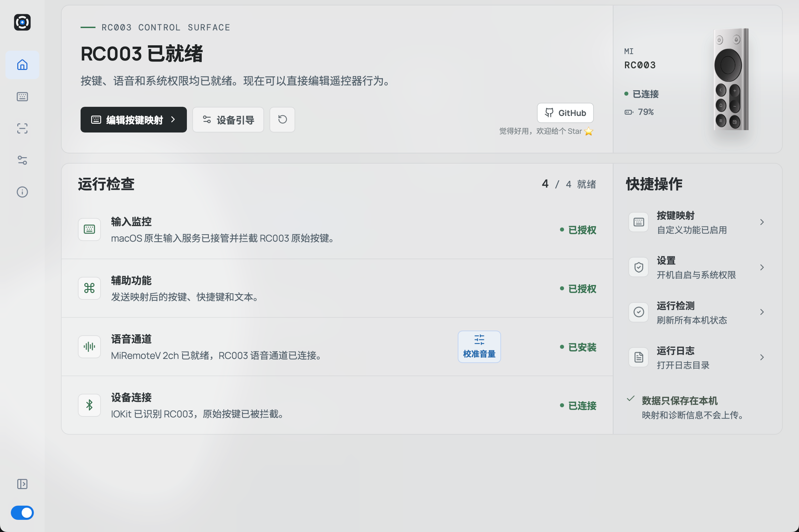
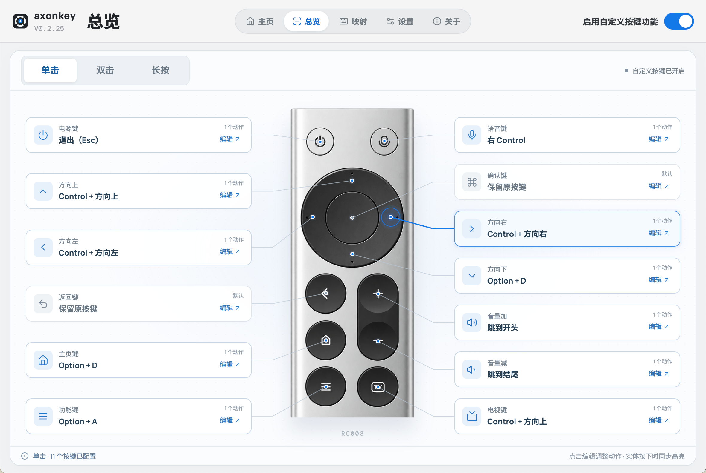
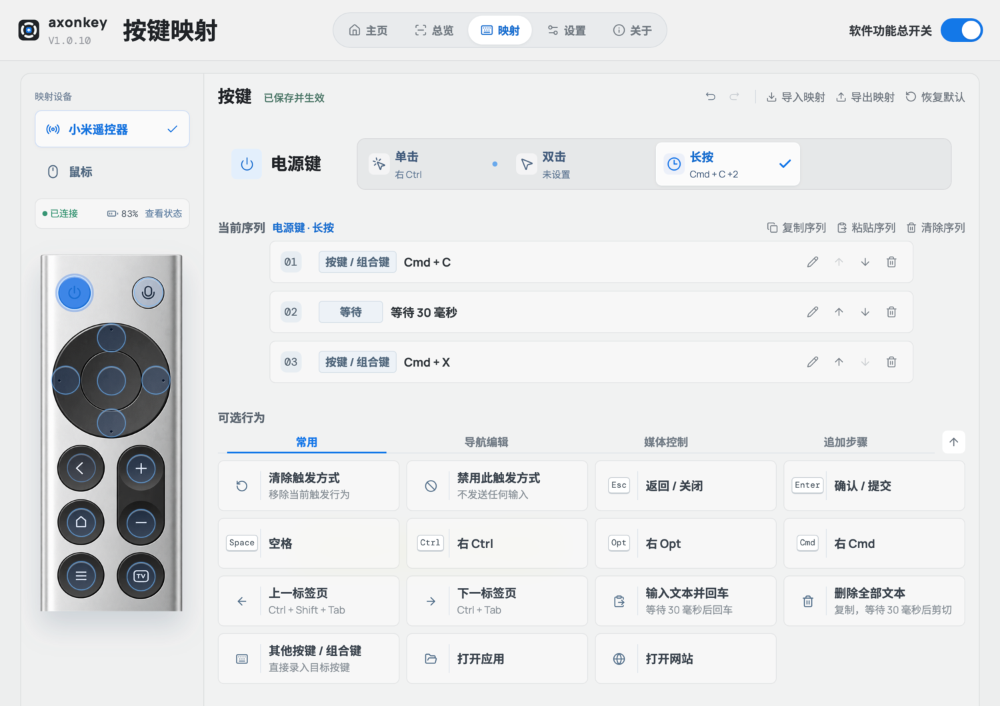

# Axonkey


[](https://github.com/leowzz/axonkey/releases/latest)
[](https://github.com/leowzz/axonkey/actions/workflows/build-tag.yml)
[](https://github.com/leowzz/axonkey/releases)
[](#系统要求)
[](#系统要求)
[](./src-tauri/Cargo.toml)
[](./package.json)

[**⬇ 下载 Axonkey（macOS / Windows）**](https://github.com/leowzz/axonkey/releases)

Axonkey 是一款支持小米蓝牙遥控器2Pro(RC003) 和鼠标输入的本地映射控制台。macOS 版通过 IOKit 读取目标设备（`VID 0x2717` / `PID 0x32B8`）的原始 HID 报告，并用 CoreGraphics 与 AppKit 发送映射后的输入；Windows 版通过 QuarborHIDFilterUserDriver 的 v3 双工 Protobuf 管道接收目标 HID 报告并写入键盘动作，并将 RC003 语音转发到 VB-CABLE。Windows 可读取包括返回和音量键在内的全部 RC003 按键，设备支持的标准键盘动作、组合键和按键替换通过驱动执行，媒体控制及设备不支持的按键使用 Windows 虚拟输入，同时支持光标移动、鼠标点击、滚轮、文本输入及打开应用／网站，详见 [Windows 输入说明](docs/WINDOWS_INPUT.md)。

设备与触发项独立于映射行为：可以在“映射”左侧切换小米遥控器和鼠标，并分别配置快捷键控制。Axonkey 不依赖第三方自动化键盘工具，配置和诊断数据均保存在本机。

> Windows 重连/睡眠后无输入：从 [v0.3.24 正式版](https://github.com/leowzz/axonkey/releases/tag/v0.3.24) 起，Windows 版会在安装 Interception 输入驱动时一并安装[重连兼容修复](#windows-断连或休眠后按键无响应)，需要重启后生效；已有驱动的升级用户可选择安装或跳过，之后仍可在设置中补装。

## 界面截图

### 首页

<p align="center">

</p>
<p align="center"><sub>设备状态、运行检查与快捷操作</sub></p>

### 总览

<p align="center">

</p>
<p align="center"><sub>查看各实体按键的映射行为，切换单击、双击和长按</sub></p>

### 映射

<p align="center">

</p>
<p align="center"><sub>选择实体按键，再分别编辑单击、双击和长按行为</sub></p>

## 主要功能

- 主页集中显示输入环境、辅助功能、语音通道、RC003 连接状态和电量，并提供对应的处理入口。
- 识别 RC003 的连接状态与输入后端状态；Windows 和 macOS 版同时读取电量。
- 为每个可识别按键分别配置单击、双击和长按行为。
- 支持鼠标左右键边缘映射与四向滚动映射，可调灵敏度、忽略滚动加速、分轴触发间隔和按键保持时间。
- Windows 通过 Quarbor HID 直接读取返回与音量键，和其他按键使用同一套映射编辑器。
- 直接选择常用行为，包括保留原按键、禁用、导航编辑和媒体控制。
- 支持单个按键、键盘录入、组合键和单独修饰键；macOS 界面会按系统习惯显示 Command 与 Option。
- 支持按顺序执行多个步骤，例如粘贴文本、等待和按下 Enter。
- 内置“输入文本并回车”行为：粘贴文本 -> 等待 30 ms -> Enter。
- 支持将完整映射导出为 JSON、重新导入或恢复默认映射。
- Windows 和 macOS 均可调节 RC003 语音输入增益（`-30 dB` 至 `+30 dB`）；Windows 输出到 `CABLE Input`，macOS 输出到 `MiRemoteV 2ch`。
- 修改后自动保存并立即应用，无需为普通映射变更重启应用或系统。
- 基础输入通道按 VID/PID 与设备实例匹配 RC003；全部 13 个按键都由 Quarbor HID 管道读取。
- Windows 首次引导可为 RC003 安装并检查 Quarbor HID 过滤驱动与 VB-Audio VB-CABLE；macOS 引导可完成系统权限、安装 MiRemoteV 2ch 虚拟麦克风并连接设备。
- macOS 授权时提供置顶小窗，可直接打开对应设置、在 Finder 中定位当前 `Axonkey.app` 并重新检测权限。
- 关闭主窗口后继续常驻 Windows 系统托盘或 macOS 菜单栏，可从托盘菜单重新显示或完全退出。

## 支持范围与限制

当前支持小米 RC003 蓝牙遥控器和系统鼠标的左右键、四向滚动。macOS 可以配置全部 13 个已识别实体按键：语音、电源、四向、确认、返回、音量 `+ / -`、主页、菜单和 TV 键。返回键默认保持 Delete（退格）行为，音量键默认保持 macOS 系统音量行为与连续按压节奏，也可以改成其他单击、双击或长按映射。长按行为首次在持续按住 600 毫秒后触发，稍作等待后会按固定节奏连续触发，松开按键即停止。

Windows 编辑器提供 13 个按键，全部使用 Quarbor HID 过滤驱动按设备实例读取。返回和独立音量 `+ / -` 直接进入与其他按键相同的映射流程。技术细节见 [Windows 输入](./docs/WINDOWS_INPUT.md)。

以下功能不在项目支持范围内：

- 其他遥控器或普通键盘型号；
- Linux；
- 云端账号、配置同步或遥测；
- 任意脚本、应用专属配置或通用自动化编辑器。

## 鼠标映射

“映射”左侧固定展示“小米遥控器”和“鼠标”两行设备选项，设备自己的状态在下方独立卡片中展示。选择鼠标后，点击抽象鼠标模型上的左键、右键、前进键、后退键或四向滚动，也可在右侧选择同一输入部位，再配置生效区域、触发方式和执行行为。

滚动只允许三个屏幕边缘，不提供“任意位置”，旧配置里的全局滚动规则会被忽略。鼠标前进键和后退键支持“任意位置”以及三个屏幕边缘；左右键只允许三个屏幕边缘，旧配置里的全局左右键规则会被忽略。每个输入部位和触发方式独立配置。滚动使用“滚动一次”，鼠标按键支持单击、双击和长按。单击在释放时执行；配置双击后等待 350 毫秒区分单击，长按在持续按住 600 毫秒时执行一次。已配置的鼠标按键用于触发行为，不再提供原始拖拽；未配置的按键保持系统原始输入。只配置双击或长按时，普通单击补发一次原始鼠标点击。

边缘范围可在“设置 → 鼠标映射 → 边缘生效宽度”调整（1–100，默认 8），顶部和左右两侧共用，按当前显示器的屏幕坐标单位计算（Windows 为像素，macOS 为点），支持多显示器，顶部角落优先使用上边缘规则。滚动未配置或全部步骤停用时保持原始输入。前进键和后退键的边缘规则优先；未配置或全部步骤停用时，沿用“任意位置”的规则，任意位置也未配置则保持原始点击。鼠标左右键不继承全局规则，未配置的边缘和非边缘区域均保持原始点击。“禁用此触发方式”会拦截输入并不发送输出。关闭全局开关时保持原始输入，取消尚未执行的鼠标映射。

四向滚动在三个屏幕边缘均可配置；左右方向需要水平滚轮或横向滚动手势。映射可复用按键、组合键、媒体控制、文本和多步骤序列。自定义输出的滚轮和鼠标点击不会再次触发映射。

Windows 使用独立的系统鼠标监听与 SendInput，不需要连接 RC003 或安装 Quarbor HID 过滤驱动；macOS 使用独立的 Quartz 事件监听，需要输入监控和辅助功能权限。这里的“鼠标”代表系统鼠标输入，多个鼠标共用这组映射。

映射修改自动保存；导入／导出包含所有设备，兼容旧版 RC003 配置和已有边缘滚动配置；“恢复默认”只重置当前设备。鼠标初始所有输入均保持原始行为，具体映射由用户自行配置。

## 设置

设置页左侧按“启动设置”“系统权限”“遥控器映射”“鼠标映射”分类，普通选项修改后自动保存。控件旁的问号支持悬停、聚焦或点击查看说明，光标离开问号与说明区域后关闭。

- **启动设置**：配置开机启动。
- **系统权限**：查看授权状态并打开系统设置；标题旁的圆形刷新按钮可重新检测。浏览器预览无法检测或更改系统权限。
- **遥控器映射**：默认显示映射页顶部的遥控器按键列表，可取消“显示遥控器按键列表”以收起；收起后仍可点击左侧遥控器图选择按键。
- **鼠标映射**：调节下表中的滚动与按键参数。映射页鼠标状态行包含权限状态、功能开关和设置图标，点击设置图标可直接进入此分类。

| 鼠标设置 | 默认值 | 范围与作用 |
| --- | --- | --- |
| 忽略滚动加速 | 开启 | 开启后按事件次数计算触发量，避免快速滚动时单条事件的滚动量增大；100% 灵敏度下每条事件触发一次。不会过滤惯性产生的额外事件。 |
| 滚动灵敏度 | 100% | 25%–400%。调高后轻微滚动更容易触发，连续滚动的触发次数也可能增加；调低可减少误触。 |
| 垂直触发间隔 | 50 毫秒 | 0–10000 毫秒，上下滚动共用间隔；0 表示不限制。 |
| 横向触发间隔 | 50 毫秒 | 0–10000 毫秒，左右滚动共用间隔；0 表示不限制。 |
| 边缘生效宽度 | 8 | 1–100，顶部和左右边缘共用，适用于滚动和鼠标按键映射；Windows 为像素，macOS 为点。 |
| 按键保持时间 | 10 毫秒 | 0–1000 毫秒，控制鼠标映射输出的按键、快捷键从按下到松开的时间；目标应用漏识别时可尝试 50 毫秒，数值越大连续触发越慢。 |

触发间隔按两个轴独立计时。例如设为 100 毫秒后，同轴每次触发后的 100 毫秒内不会再次触发；被忽略的滚动不会积累或延后补发。一次触发仍会执行配置的完整行为序列。灵敏度和忽略加速适用于三个屏幕边缘的滚轮映射。

## 默认映射


| RC003 按键 | 单击行为 |
| --- | --- |
| 语音键 | 右 Alt（`RAlt`，macOS 界面显示为右 Option） |
| 电源键 | Escape（`Esc`） |
| 其他可配置按键 | 保留原按键 |

## 系统要求

| 平台 | 按键输入 | 可配置按键 | RC003 语音 | 当前结论 |
| --- | --- | ---: | --- | --- |
| macOS 13+ | IOKit 原始 HID + CoreGraphics / AppKit | 13 | ATVV -> IMA ADPCM -> `MiRemoteV 2ch` | 支持按键映射与语音；需要输入监控与辅助功能权限 |
| Windows 11 x64 | Quarbor HID 过滤驱动 | 13 | ATVV -> IMA ADPCM -> `CABLE Input`，应用从 `CABLE Output` 收音 | 为 RC003 绑定 Quarbor 驱动；语音另需 VB-CABLE |

### Windows

- 64 位 Windows 11；
- 已通过 Windows 蓝牙设置配对的 RC003；
- QuarborHIDFilterUserDriver UMDF 输入过滤驱动（只绑定 RC003 枚举 HID 设备）；
- 需要虚拟麦克风时安装 VB-Audio VB-CABLE Pack45；
- 首次安装或卸载上述驱动时需要管理员权限；设备重新连接或 Windows 重启可能由系统按需要求。

Axonkey 使用 QuarborHIDFilterUserDriver 的 x64 UMDF 包，因此不支持 32 位 Windows。输入服务按设备实例和 VID/PID 只为 RC003 连接对应管道。

### macOS

- macOS 13 Ventura 或更高版本，支持 Apple Silicon 与 Intel；
- 已通过系统蓝牙设置配对的 RC003；
- 在“隐私与安全性”中授予 Axonkey“输入监控”和“辅助功能”权限。
- 使用 RC003 麦克风时安装 Axonkey 提供的 `MiRemoteV 2ch` 虚拟音频驱动；安装或卸载需要管理员权限，不需要重启系统。

macOS 按键映射不需要安装输入驱动。未启用自定义映射，或两项权限尚未同时授予时，Axonkey 只做非独占设备监听，不会吞掉遥控器原始按键。启用映射且权限就绪后，应用会优先独占匹配的 RC003 HID 设备；如果系统不允许独占，则继续监听 HID 报告，并通过事件过滤器只拦截对应的 RC003 原始按键，再发送映射后的输入。

语音转发是独立链路：Axonkey 通过 CoreBluetooth 连接 RC003 的 ATVV 语音服务，将 16 kHz IMA ADPCM 解码为 PCM，再写入 `MiRemoteV 2ch` 的输出端；豆包输入法等应用选择同名输入端即可收音。连接就绪后会提前准备音频输出，连续说话时复用输出链路，减少按键后的启动延迟；空闲 5 秒后暂停音频引擎，遥控器断开或退出 Axonkey 后释放输出。

## Windows 首次使用

1. 在 Windows 蓝牙设置中配对并唤醒 RC003。
2. 启动 Axonkey，按照首次使用引导检查设备和驱动。
3. 在“驱动安装”页面为当前 RC003 安装 Quarbor HID 过滤驱动；需要语音时同时安装 VB-CABLE。按页面提示重新连接设备或重启 Windows。
4. 重新打开 Axonkey，选择遥控器按键及触发方式，然后设置目标行为。
5. 打开“启用自定义按键功能”开关。

Quarbor 和 VB-CABLE 只需安装一次。之后添加、删除或修改映射不需要再次重启。

从源码目录或解压后的发行目录也可以直接使用安装器 CLI：

```powershell
$installer = '.\vendor\QuarborHIDFilterUserDriver\QuarborHIDFilterUserDriverInstaller.exe'
& $installer --list
# 将下方字符串替换为 --list 中 RC003 的 instanceId。
$rc003Id = 'RC003 的完整设备实例 ID'
& $installer --install $rc003Id
```

查询不请求管理员权限；安装器在安装、卸载时自行申请 UAC，并管理驱动包和设备恢复记录。应用安装时只对 RC003 的 HID 键盘实例执行操作，卸载时调用 `--uninstall-all` 彻底移除 Quarbor 绑定，因此设备离线也可以处理。退出码 `3010` 表示需要重启，`1223` 表示取消授权。完整说明见 [安装器 CLI 文档](vendor/QuarborHIDFilterUserDriver/Docs/quarbor-hid-user-installer-cli.md)。

也可以手动启动仓库中经过校验的 VB-CABLE 安装流程：

```powershell
powershell -ExecutionPolicy Bypass -File .\scripts\vbcable-driver.ps1 -Action install
```

该脚本校验未修改的官方 Pack45 ZIP、x64 安装器哈希和发布者签名，随后申请管理员权限并打开 VB-Audio 官方安装窗口。安装完成后需要重启 Windows，录音设备列表中会出现 `CABLE Output (VB-Audio Virtual Cable)`。

Windows 语音链路由 Axonkey 直接维护：应用通过 Bluetooth GATT 连接 RC003 的 ATVV 服务，解码 16 kHz IMA ADPCM 音频并写入 `CABLE Input` 播放端点；录音应用选择 `CABLE Output (VB-Audio Virtual Cable)` 作为麦克风。按住语音键时才会建立或恢复语音会话，主页的增益滑杆（`-30 dB` 至 `+30 dB`）只作用于这一路音频。

> **Windows 音频设置提醒：** 微信输入法语音输入可能压低其他媒体音量，甚至中断播放。麦克风请选择 `CABLE Output`；系统和应用的扬声器输出请保留真实扬声器或耳机，不要选择 `CABLE Input` 等虚拟设备。Axonkey 会自行向 `CABLE Input` 写入遥控器语音，无需将其设为系统默认播放设备。

## macOS 首次使用

1. 打开 DMG，将 `Axonkey.app` 拖入“应用程序”，再从“应用程序”启动它。不要长期直接运行 DMG 中的副本，否则后续授权可能指向临时挂载路径。
2. 在 macOS 蓝牙设置中配对 RC003，并按任意键将遥控器唤醒。
3. 在“权限与音频”中先点击“输入监控”的“开始授权”，Axonkey 会打开“隐私与安全性”中的对应列表，并缩成屏幕右上角的置顶授权小窗。
4. 如果系统列表中没有 Axonkey，点击小窗中的“在 Finder 中显示”，将高亮的 `Axonkey.app` 拖入授权列表并打开开关；随后以相同方式完成“辅助功能”。小窗与主界面会自动重新检测权限，也可以手动点击“重新检测”。
5. 需要语音时点击“安装驱动”，完成管理员授权后确认界面显示 `MiRemoteV 2ch` 已安装；在豆包输入法中也选择 `MiRemoteV 2ch` 作为麦克风。
6. 返回完整窗口，确认 RC003 已连接，配置目标行为并打开“启用自定义按键功能”。

输入监控用于读取 RC003 的原始 HID 报告，辅助功能用于过滤原始系统事件并发送映射后的按键、快捷键或文本。权限跟应用的代码签名身份关联：频繁安装不同 ad-hoc 本地构建时，如果界面仍显示“待授权”，请在系统设置中移除旧 Axonkey 条目，再通过 Finder 重新添加当前 `Axonkey.app`；如果系统明确要求退出并重新打开应用，请按提示操作。

点击窗口左上角关闭按钮只会隐藏主窗口，Axonkey 仍常驻 macOS 菜单栏并继续处理映射。从菜单栏图标选择“显示 Axonkey”可恢复窗口；关闭“自定义按键功能”或选择“退出 Axonkey”才会释放 HID 捕获和事件过滤，让遥控器恢复由 macOS 直接处理。

### macOS 自签名版本的信任与限制

部分 GitHub Actions 或本地构建使用 Axonkey 的自签名证书，而不是 Apple Developer ID。此类版本不会通过 Apple 公证，首次启动时可能显示“无法验证开发者”“开发者无法验证”或“应用已损坏”；随应用提供的 `MiRemoteV 2ch` 安装包也可能出现类似提示。自签名只解决代码身份在不同版本之间保持稳定的问题，不会让 macOS 自动信任下载来源，也不等同于输入监控或辅助功能授权。

首次启动被拦截时：

1. 先将 DMG 中的 `Axonkey.app` 拖到“应用程序”，不要长期直接运行 DMG 内的副本。
2. 在 Finder 的“应用程序”中按住 Control 点击 `Axonkey.app`，选择“打开”，再在确认对话框中点击“打开”。这是 macOS 对该自签名应用建立本机例外的方式。
3. 如果没有出现“打开”按钮，打开“系统设置 -> 隐私与安全性”，滚动到“安全性”区域，点击“仍要打开”，然后重新启动 Axonkey。
4. 安装 `MiRemoteV 2ch` 时若安装器被拦截，也在 Finder 中对对应 PKG 选择“打开”；只有在确认文件来自本项目且校验和匹配 Release 页面时才执行此操作。

应用能够启动后，仍需在“隐私与安全性 -> 输入监控”和“隐私与安全性 -> 辅助功能”中分别添加当前“应用程序/Axonkey.app”并打开开关。若升级后界面再次显示“需要重新授权”，先移除列表中的旧 Axonkey，再通过 Finder 重新添加当前版本；证书信任不能替代这两项 TCC 权限。自签名证书丢失或被重新生成后，macOS 也会将后续构建视为新的应用身份，因此发布者必须长期保留同一套证书和私钥。

## 卸载输入驱动

先退出 Axonkey 和其他使用 Quarbor 驱动的工具，再运行：

```powershell
$installer = '.\vendor\QuarborHIDFilterUserDriver\QuarborHIDFilterUserDriverInstaller.exe'
& $installer --list
$rc003Id = 'RC003 的完整设备实例 ID（可以离线）'
& $installer --uninstall $rc003Id
```

安装器会申请管理员权限，并返回是否需要重启 Windows。也可以运行 `make uninstall-driver DEVICE="设备实例 ID"`。应用内“卸载驱动”使用安装器的 `--uninstall-all`，会解除所有设备的 Quarbor 绑定并清理未使用的驱动包。

## 本地开发

开发环境需要 Node.js 与 Rust stable。Windows 还需要 MSVC 构建工具和 WebView2；macOS 开发应用需要 Xcode Command Line Tools，构建 MiRemoteV 驱动和发布包需要完整 Xcode。macOS/Linux shell 中安装依赖并启动 Tauri 桌面应用：

```bash
cp .env.example .env
npm install
npm run tauri dev
```

Windows PowerShell 使用 `Copy-Item .env.example .env` 创建本地版本文件，其余命令相同。

`.env` 是本机版本来源并被 Git 忽略，只允许包含一行 `version=vX.Y.Z`（可附加 `-alpha.N`、`-beta.N` 或 `-rc.N`，N 为正整数）。首次检出时从已提交的 `.env.example` 复制；`make release` 会同时更新本地 `.env`、`.env.example` 和各框架清单中的版本。

检查前端生产构建和 Rust 测试：

```bash
npm run build
cargo test --manifest-path src-tauri/Cargo.toml
```

项目也提供 Makefile：

```bash
make dev
make build
make build-macos-audio
make build-macos
make test-release
make release
make release V=v0.1.25
```

预发布沿用同一套发版和构建流程：

```bash
make release V=v1.2.3-beta.1
make release RC=1          # 当前为 v0.2.29 或 v0.2.29-alpha.1 时，生成 v0.2.30-rc.1
make release V=0.2.30 RC=3 # 生成 v0.2.30-rc.3（V 也可带 v 前缀）
# 后续显式指定 beta.2、rc.1，或正式版 v1.2.3
```

`make release` 只同步版本、创建提交和本地 annotated tag，不自动推送。推送 `v*` tag 后，
CI 先校验版本和远端分支归属，再运行测试并构建 Windows NSIS、macOS Universal 安装包。
预发布使用相同的签名、公证配置，发布为 GitHub Pre-release，不占用 Latest；正式版发布为 Release。
当前为预发布版本时，必须显式传入 `V` 或 `RC`；两者均不传时会拒绝执行。正式版不传两者仍递增 patch。
`RC=N` 要求 N 为无前导零的正整数；不传 `V` 时，去掉当前预发布后缀并递增 patch，再追加 `-rc.N`。
同时传入 `V` 和 `RC` 时直接使用指定基础版本（支持带或不带 `v` 前缀），此时 `V` 不能附带预发布后缀。
版本顺序为 `alpha.N < beta.N < rc.N < 正式版`，不接受低于当前版本的发版请求。

仅正式版附带 `latest.json`。所有客户端继续从最新正式 Release 检查更新；预发布之间需手动安装，
同版本预发布可更新到正式版。预发布与正式版共用应用标识及配置目录，安装时会覆盖已有应用。

`.env` 不纳入 Git，且只包含一行 `version=vX.Y.Z`，支持上述预发布后缀。`make build` 只校验 `.env` 与 npm、Cargo、Tauri
版本一致，然后根据当前平台构建安装包，不修改版本文件或 Git 状态。Windows 生成 NSIS 安装程序，macOS 生成 DMG：

```text
Windows: src-tauri\target\release\bundle\nsis\Axonkey_<version>_x64-setup.exe
macOS:   src-tauri/target/release/bundle/dmg/Axonkey_<version>_<arch>.dmg
```

Windows 安装包使用 `src-tauri/windows/installer.nsi` 自定义模板：已有 NSIS 安装直接覆盖，
升级或同版本重装时不再显示“先卸载 / 不卸载”选择页，也不会调用旧版卸载程序。
安装目录恢复、运行中程序检查和独立卸载入口仍由 Tauri 模板处理；WiX/MSI 迁移保留原有流程。
模板基于 `tauri-cli-v2.11.4`，升级 Tauri CLI 时需同步检查上游模板变更。

`make build-macos` 使用同一版本校验，并生成当前架构的 `.app` 与 `.dmg`：

```text
src-tauri/target/release/bundle/macos/Axonkey.app
src-tauri/target/release/bundle/dmg/Axonkey_<version>_<arch>.dmg
```

`make build-macos-audio` 可单独从固定的 BlackHole 源码构建 MiRemoteV 驱动及安装、卸载 PKG；`make build` 和 `make build-macos` 在 macOS 上会自动执行这一步。

设置 `APPLE_SIGNING_IDENTITY` 后，`make build-macos` 会用该证书签名 App 和 DMG；此时还需通过 `MACOS_INSTALLER_SIGNING_IDENTITY` 指定钥匙串中的安装包签名证书，否则构建会拒绝嵌入未签名的 MiRemoteV PKG。构建流程支持自签名证书和 Developer ID 证书。两项 identity 都不设置时，App 使用 ad-hoc 签名，MiRemoteV PKG 不签名。输入监控和辅助功能权限绑定代码签名身份，经常安装本地构建时应固定使用同一签名证书。ad-hoc 构建每次变化后都可能需要移除旧权限条目并重新授权。

自签名分发包的首次安装与授权步骤见上方“macOS 自签名版本的信任与限制”。使用 Developer ID 签名并配置 Apple 公证凭据时，CI 会执行公证流程。

`make release` 要求 Git 工作区完全干净。未传 `V` 时，它从 `.env` 递增 patch；也可以用 `V=vX.Y.Z` 指定版本。命令会同步 `.env.example`、npm、Cargo 和 Tauri 版本，创建 `chore: release vX.Y.Z` 提交，再在该提交上创建 annotated tag。它不会构建、推送或发布远端 Release。

## 工作原理

```text
Windows input: RC003 -> Quarbor HID pipe -> HID usage -> 扫描码 -> 行为状态机 -> SendInput
Windows voice: RC003 -> Bluetooth GATT ATVV -> IMA ADPCM -> PCM -> CABLE Input -> CABLE Output
macOS input:   RC003 -> IOHIDManager -> HID usage -> 行为状态机 -> CoreGraphics / AppKit 发送
macOS voice:   RC003 -> CoreBluetooth ATVV -> IMA ADPCM -> PCM -> MiRemoteV 2ch
```

输入服务只为识别出的 RC003 设备设置过滤条件。设置更新采用本地快照，界面保存后会直接替换输入服务中的当前配置。

更多实现信息见 [架构说明](./docs/ARCHITECTURE.md)、[产品范围](./docs/PRODUCT.md) 和 [Windows 输入说明](./docs/WINDOWS_INPUT.md)。

## 运行日志

Axonkey 会在本地记录启动、设备连接、输入/音频服务、系统探测和命令失败等运行时信息，不会上传日志，也不会记录映射文本内容。主页“运行日志”按钮可以直接打开日志目录，将 `axonkey.log` 和需要的滚动旧日志一起发送即可。

日志按文件大小滚动：单个文件达到 5 MB 后自动切换，并保留最近 5 个旧文件。Tauri 默认日志目录为：Windows 的 `%LOCALAPPDATA%\com.axonkey.app\logs`，macOS 的 `~/Library/Logs/com.axonkey.app`。驱动安装器仍会把单独的安装输出写入下方的 `Axonkey\logs` 目录。

Windows 音频链路常驻 INFO 级诊断，不需要开启调试模式。连接时记录协商的协议、编码、帧大小和 CABLE 输出格式；语音活动期间约每秒输出一条 `RC003 audio diagnostics`，短会话会汇入下一个统计窗口，连接关闭时补记剩余统计。空闲且没有音频数据或控制事件时不刷日志，不保存音频包内容、PCM 或识别文本。

- `window_ms` 为实际统计窗口长度，各计数是窗口增量，不是会话总量；跨线程计数是近似快照。`starts/stops/syncs` 统计收到的控制事件，不表示音频已经成功输出。
- `rx_packets/rx_bytes/last_rx_ms` 表示收到的音频通知数量、字节数和距最后一包的毫秒数（`never` 表示服务启动以来尚未收包）；`rejected_packets` 是因空包、未就绪或停止保护窗口等原因未进入解码的包数，`notification_read_errors` 是读取音频或控制通知失败的次数。
- `decoded_samples/pcm_peak/pcm_rms` 表示解码后的单声道样本数、峰值和 RMS（增益前的 i16 幅度，绝对满幅为 32768）。持续收包但这些电平接近零，说明解码后的信号近乎静音，不能单凭此项认定硬件故障。
- `output_callbacks/consumed_samples` 表示播放回调次数和从队列取出的 16 kHz 源样本数，不保证下游录音应用已收到声音。`unfilled_output_frames` 是因没有足够样本等原因填零的输出帧数（按输出采样率计，不等于内容本身静音）；`queue_busy_callbacks` 是未取得队列锁的回调数，`overflow_samples` 是队列溢出丢弃的源样本数。会话边缘和空闲窗口的填零是正常现象。
- `streaming/microphone_opened/session_id/queued_samples/gain_db` 提供控制状态、队列余量和增益上下文。排查只有按下瞬间有电平时，保持按住语音键连续说话约 10 秒，再提供包含开始、周期统计和停止事件的日志。

macOS 同样常驻 INFO 级诊断，使用 `macOS RC003 audio diagnostics` 标识，共用收包、拒收、通知读取错误、增益前 PCM 电平和控制事件统计。每秒汇总，空闲不写日志，暂停或停止服务时补记并取消定时器；不保存语音内容。状态变化、协议协商、输出格式和语音命令提交也会进入运行日志。

- macOS 输出采用 AVAudioSourceNode 和有界 PCM 环形队列。`scheduled_samples` 是成功入队的 16 kHz 单声道样本数；`completed_buffers/rendered_samples` 由主线程轮询已取出的完整 PCM 块后累加，会有统计延迟，也不能证明下游录音应用已收音。`enqueue_failures/enqueue_failed_samples` 为入队失败的块数和样本数；`enqueue_invalid/enqueue_output_unavailable/enqueue_queue_full` 区分无效输入、输出未就绪和队列容量不足（Rust 桥未建立时不会调用原生入队，因此可能只有总失败数）。
- `pending_buffers/engine_running/output_prepared/output_verified/drain_requested` 表示待完成块数、引擎运行、输出节点存在、路由验证和尾音排空状态。`queued_samples` 是当前剩余样本，`underruns` 是窗口内非排空状态下队列耗尽次数。输出重置时，`discarded_pending_buffers` 统计尚未确认完成的块数，`discarded_queued_samples` 统计确实仍留在队列中的样本；部分已取出的块可能仍在待完成列表，二者不能直接按块大小换算。
- `audio_callbacks/callback_bytes/notification_min_bytes/notification_max_bytes` 在音频特征的回调入口统计（错误回调的 value 可能为空或是旧值，不代表新音频）；`callback_stale/callback_read_errors/callback_missing_value` 按处理顺序分别统计旧连接、读取错误、缺失 value。通过这些检查后才计入 `rx_packets/rx_bytes`；随后拒收按 `rejected_not_ready/rejected_empty/rejected_after_stop` 区分未完成协商、空包和停止后 300 ms 保护窗口，进入解码的通知计入 `accepted_packets/accepted_bytes`。控制通知错误仍包含在共用的 `notification_read_errors` 中。
- `callback_gap_ge20/ge50/ge100/ge250` 是语音会话内相邻有效连接音频回调入口间隔达到各毫秒阈值的次数，阈值累计计数；`max_callback_gap_ms` 为最大值。统计跨越一秒汇总边界，但不包含两次按键之间的静默。`max_callback_handler_ms` 包含本次回调中的协议处理、同步解码与入队耗时；`max_packet_gap_ms` 保留原有的接受包间隔。`callback_wait_ms=unknown transport_arrival=unknown` 明确表示无法观测 CoreBluetooth 回调前的排队时间或无线到达时间，不能将回调间隔直接解释成无线丢包。
- `rx_packets_per_second` 按实际窗口计算收包速率；`decoded_ms` 是解码样本对应的音频时长；`decoded_window_percent` 是该音频时长占整个统计窗口的百分比，**不是丢包率**。会话边缘、批量延迟到达都可能影响这个比例，甚至超过 100%。`decoder_pending_bytes` 是解码器当前不足一帧的残包字节数，`decoder_discarded_bytes` 是窗口内同步或会话重置时清掉的残包字节数；`connection_generation/session_id` 用于关联连接与会话。

这些统计借鉴了 remote-mic-app 的分段诊断思路，仅记录计数与时序，不调整蓝牙线程、协议或音频缓冲策略。分析持续断续时，应对照同一会话中部的连续窗口，检查回调供给、接受/解码、入队失败与欠载，避免只凭单个指标归因。

## 隐私与恢复

- Axonkey 不需要账号，不上传映射、输入历史或诊断信息。
- 映射配置保存在本机应用数据中。
- Windows 驱动安装和卸载日志位于 `%LOCALAPPDATA%\Axonkey\logs`。
- macOS MiRemoteV 安装和卸载日志位于 `~/Library/Logs/Axonkey`。
- Windows 中退出 Axonkey 会关闭 Quarbor HID 管道，停止处理自定义映射。
- macOS 中关闭主窗口不会退出应用；关闭自定义映射或从菜单栏选择“退出 Axonkey”后，HID 捕获与事件过滤才会停止。

### Windows 断连或休眠后按键无响应

Quarbor 驱动按设备实例发布独立管道。设备重新枚举后，Axonkey 会按新的实例 ID 重连对应管道；若驱动安装状态异常，请在引导中重新检测或重新绑定 RC003。

### 长时间说话时音频延迟

长时间按住 RC003 语音键连续说话时，音频可能逐渐出现延迟。目前在 macOS 上观察到约 1.8～2 秒的延迟，松开语音键时还可能丢失末尾的一部分语音。

此问题尚未解决，需要完整录制长段语音时请留意这一限制。已知现象、测量结果和排查进展见 [RC003 音频延迟说明](./docs/RC003_AUDIO_LATENCY.md)。

## Quarbor HID 许可

QuarborHIDFilterUserDriver 按随驱动包提供的免费使用／禁止转售许可证分发。具体条款见 [vendor/QuarborHIDFilterUserDriver/License](./vendor/QuarborHIDFilterUserDriver/License) 和 [THIRD_PARTY_NOTICES.md](./THIRD_PARTY_NOTICES.md)。

## VB-CABLE 许可

VB-CABLE 是 VB-Audio Software 提供的 Donationware。Axonkey 原样携带官方 Pack45 ZIP，并在引导中明确展示其来源；如果你认为 VB-CABLE 有用或将其用于专业场景，请通过 [VB-Audio 官方页面](https://vb-audio.com/Cable/) 捐赠或购买许可。

版本、哈希和分发说明见 [THIRD_PARTY_NOTICES.md](./THIRD_PARTY_NOTICES.md) 与 [vendor/vbcable/SOURCE.md](./vendor/vbcable/SOURCE.md)。

## MiRemoteV 2ch 许可

`MiRemoteV2ch.driver` 由 Axonkey 从固定的 BlackHole v0.7.1 源码和仓库内补丁构建，采用 GPL-3.0。构建配方、对应源码提交和修改说明见 [THIRD_PARTY_NOTICES.md](./THIRD_PARTY_NOTICES.md) 与 [third_party/blackhole/README.md](./third_party/blackhole/README.md)。

## 相关项目

Axonkey 的产品灵感来自 [HD838A/remote-mic-app](https://github.com/HD838A/remote-mic-app)。macOS 原生后端参考了该项目经真机验证的 RC003 VID/PID、HID usage、ATVV 语音协议、IOKit 权限检查、CoreGraphics 键盘注入和 Core Audio 输出路径；Axonkey 仍维护独立的 Tauri 界面、设置格式、驱动构建和运行时服务。

Axonkey 与 remote-mic-app 是相互独立的项目，本仓库不是其 fork。
