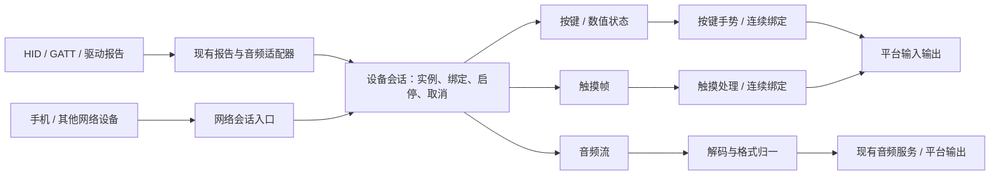

# 设备输入源：网络、连续触摸与音频

状态：`proposed`，仅设计，尚未实现。对应 [Issue #58](https://github.com/leowzz/axonkey/issues/58) 与 [ADR 0003](adr/0003-transport-independent-device-input.md)。现有已实现协议仍是 [axonkey.device/1](DEVICE_DESCRIPTOR_SVG.md)。

目标是让手机、其他计算机或硬件设备通过网络提供按键、连续数值、触摸和音频，与现有 HID/GATT 设备共用实例、SVG 配置和运行生命周期。统一的边界应是“设备提供什么输入”，传输方式由适配器处理。

## 1. 总体边界



| 层 | 负责 | 数据边界 |
| --- | --- | --- |
| SVG 设备定义 | 型号、稳定输入 ID、图形和精确热区、输入种类、允许的格式、必需能力 | 静态声明 |
| 来源适配器 | HID 报告解码、GATT 分片、网络协议与入口校验 | 外部数据转成已确定类型的输入 |
| 设备会话 | 实例绑定、当前连接、配置快照、各类输入生命周期与取消 | 按 `instanceId` 隔离 |
| 控制与触摸处理 | 状态、阈值、按键手势、触摸识别、连续输出绑定 | 不处理音频负载 |
| 音频服务 | 流状态、解码、重采样、增益、有界 PCM 队列及输出 | 不产生按键动作 |
| 前端 | 编辑映射、状态反馈、触点预览与电平 | 只订阅展示快照，不中转原始数据 |

网络输入不要求安装 HID 驱动。系统键鼠注入仍取决于平台权限和输出后端；输出为其他应用可选择的麦克风时，仍使用 Windows Quarbor / macOS MiRemoteV 虚拟音频设备。应用内部消费 PCM 则不需要虚拟麦克风。

第一版采用少量枚举、状态结构和适配函数，不增加插件总线、媒体处理图或可执行 SVG。SVG 的下载分发与网络输入是独立问题，设备定义先随软件内置。

## 2. 三类输入的运行契约

### 2.1 按键与连续数值

来源适配器向状态引擎提交 **来源组的完整状态快照**。这与现有 `state-group` 的替换语义一致：本组未出现的输入回到中立值，其他组不受影响。发送端不能把单个变化当完整快照，否则会释放同组仍按住的键。

| 种类 | 值 | 消费方式 |
| --- | --- | --- |
| `button` | `0` / `1` | 边沿进入现有单击、双击、长按识别 |
| `trigger` | `[0,1]` | 保留连续值；声明按钮触发时才应用阈值与滞回 |
| `axis` | 声明范围内的绝对值，例如 `[-1,1]`，有明确中立值 | 进入连续绑定，不能自动当作按键 |
| `encoder` 等相对量 | 有符号增量 | 进入增量处理；合并时累加，不能用绝对状态覆盖 |

第一阶段只让既有控制值和新的网络按钮共用 `apply_values(group, values)`，保留现有多来源取最大值的行为。这个规则适用于已有非负按钮、扳机及已拆成方向的轴/帽值；v1 Xbox 的方向和阈值按钮触发由兼容适配显式保留，不能因新类型路由丢失。新 v2 绝对轴默认连续、首版只允许一个来源，不把有符号轴或相对增量套入 `max`。以后确需多来源轴时，再明确其合并规则。

按键生命周期事件按顺序处理，不能为了降频跳过短暂的按下/释放。UI 快照可合并，执行输入不能跟随 UI 的 40 ms 节流。相对量不是首版网络消息的另一种写法，需要时再增加独立消息类型。

### 2.2 连续触摸

触摸输入由稳定的 `surfaceKey` 标识，帧包含同一采样时刻的一组触点变化：

```json
{
  "type": "touch", "seq": 12, "tUs": 240000,
  "key": "mobile.remote.touchpad",
  "changes": [
    { "id": 7, "phase": "down", "x": 0.31, "y": 0.62, "pressure": 0.5 },
    { "id": 8, "phase": "move", "x": 0.68, "y": 0.61 }
  ]
}
```

这是生命周期片段：触点 8 必须在此前已经 `down`，同一帧可以同时开始一根手指并移动另一根。

- 坐标是触摸面本地的 `[0,1]`，左上角为原点，x 向右、y 向下。设备旋转由发送端归一到声明的方向；与 SVG `viewBox`、手机像素和桌面坐标分开。
- `id` 在当前会话、当前触摸面内唯一，触点结束后才可复用。`pressure` 可选、范围 `[0,1]`，未提供不等于压力为零。
- `down → move* → up` 是正常接触；`cancel` 撤销当前接触，不产生点按、拖放确认或手势完成动作。
- `up` 携带最终位置；`cancel` 可只带 ID。整帧校验后原子应用，不让半个双指采样进入识别器。
- 可靠有序通道中不接受未知触点的 `move/up` 或重复 `down`；入口报告协议错误并取消该触摸面，避免内部猜测接触状态。
- 手机切到后台、页面失焦或系统中断触控时，首版关闭会话，由接收端统一取消；恢复使用时重新握手，触点从新的 down 开始，不补发中断前的 move。

浏览器客户端可把 Pointer Events 的 pointer ID 和 down/move/up/cancel 转成上述协议，但这只是采集适配，不把 DOM 事件对象直接当网络协议。取消和合并采样的语义参考 [W3C Pointer Events](https://www.w3.org/TR/pointerevents3/)。

**触摸数据、触摸映射和系统原生触控是三个独立能力。** 接收到坐标不代表已经支持系统多点触控。首个连续绑定可实现相对触摸板移动、点按和双指滚动；拖动需要显式持有/释放鼠标键。绑定参数（灵敏度、滚动方向、目标屏幕等）保存在实例 profile，不写进设备 SVG。具体手势未实现时，不宣称可用。

连续输出直接消费采样，不能每次 move 都创建一条现有“单击动作序列”。绝对位置消费者可以取最新位置；轨迹/速度识别器保留所需采样；相对移动和滚动合并时累加。允许丢弃的只是对应消费者已明确允许舍弃的 move，不丢 down/up/cancel，也不跨这些边界合并。

### 2.3 音频

音频是独立输入流，可以没有任何按键。录音策略与数据传输分开：客户端主动开始，或某个按钮按住/单击请求开始；“请求录音”和“实际收到音频”是不同状态。

每路音频有静态 `streamKey`，每次开始有新的运行时 `streamId`：

```text
idle → audio.start → 接受格式 + audio.ready → audio.data* → audio.end → draining → idle
                                             └────────→ audio.cancel ──────────→ idle
```

- `start` 提交编码、采样率和声道，接收端确认可用后才发送数据；不在帧间悄悄更改格式。
- 帧使用递增序号与 `sampleOffset`。偏移是从本次流开始累计的**每声道采样帧数**，不是字节数；48 kHz 的 20 ms 是 960，与声道数无关。
- 首帧偏移为 0，连续帧的偏移为上一帧偏移加 `frameSamples`。发送端丢弃待发音频后，偏移仍按采样时轴前进；前跳表示中断，清除过期队列并重新预缓冲，不按整个空档补回静音。序号或偏移重复、倒退在入口拒绝。
- PCM 第一版支持 `pcm-s16le`、16 kHz、单声道，默认每帧 20 ms（640 字节）。接收端允许合法的 10–40 ms 块并重新分块，不继承 A15 固定 320 samples 的限制。
- 手机通常采到其他采样率时，由客户端连续归一到协商格式，跨采集块保持重采样相位和余量；`sampleOffset`、`frameSamples` 都按归一后的采样率计数。接收端以后增加 48 kHz 时同样复用有状态重采样器，不能只改采样率标签。
- 第一版不要求压缩。Opus 可作为后续注册的编码能力，需实际增加解码器和测试后才能协商；格式定义参考 [RFC 6716](https://www.rfc-editor.org/rfc/rfc6716)。不默认接受浏览器 MediaRecorder 输出的容器数据。
- 解码后的通用 PCM 块只带采样率、声道和样本。HID 分片头、加密信息、厂商 group 等留在各解码器内。
- 正常 `end` 作为该流队列中的有序结束标记：停止接收后续数据，处理此前已接收块，在剩余延迟预算内排空后关闭。`cancel`、断连、禁用立即使该流失效并清队列。新 `start` 重置分片、解码和重采样状态，不播放上一轮缓存。

音频路线为“来源 → 分片/解码 → 格式归一 → 每流增益及队列 → 现有平台输出”。开始先复用当前 16 kHz 单声道输出能力，再逐步把设备专用 PCM 入口改成中性接口，不一次重写现有 GATT/HID 采集。

同一实例的流按 `streamId` 隔离，首版每实例最多一条 active/draining 音频流，重复开始明确拒绝；需要替换时先取消旧流，再申请新流。多个设备同时输出到同一个系统麦克风时，由输出服务负责混音，不能让后来的设备覆盖前一只设备的流状态。

## 3. 会话、顺序与积压

### 实例与连接

沿用“设备类型 → 设备实例 → 绑定 → 后台会话”。网络设备的稳定 peer 身份来自配对；IP/端口只用于本次连接定位。首次配对由用户在桌面确认，后续使用配对凭据；SVG 和配置不保存凭据或运行时地址。

服务端将已配对 peer 绑定到已有实例，再分配本次 `sessionId`。数据包不允许自行指定其他 `instanceId` 或执行任意行为序列，只能提供该定义允许的输入。同一来源只保留一个活动会话；替换连接先取消旧会话，再从中立状态开始。

断连、解绑、禁用、退出，以及需要取消旧映射的配置切换，统一执行：取消待定按键/触摸手势、释放该会话持有的输出、归零控制状态、取消触点和音频流。取消不能通过正常 release 路径意外合成单击。其他实例持有的同名键和音频流不受影响。首版网络来源遇到这些切换就关闭会话；客户端清空本地状态，恢复后重新握手，持续接触必须结束后重新按下，音频重新申请开始，不另建暂停协议。

网络活跃检查使用接收端单调时间；首版默认每 1 s 心跳、连续 3 s 无消息则取消会话。明确关闭或收到传输错误时立即取消，不等心跳。手机失焦/停用时关闭会话，不继续保留拖动或录音状态。网络不可见中断时，释放延迟最多受该超时约束，实机需要单独验证。

### 时间与序号

JSON 消息 `seq` 在本会话内递增；音频帧 `seq` 按 `streamId` 单独递增。`tUs` 是发送端本会话内的单调采样时间，单位微秒，不是 Unix 时间。接收端按有序通道处理，不为首版 TCP 再做乱序重排。

按键单/双击与长按计时继续使用接收端单调时间。触摸的采样间隔可使用发送端时间；音频以采样偏移保持连续。本版不承诺跨机器时钟相等或触摸/音频精确同步，不因有时间戳就自动获得同步能力。

### 队列与调度

| 数据 | 积压处理 |
| --- | --- |
| 按键状态、触点生命周期、开始/结束/取消 | 有界按序处理，不静默丢失；消费跟不上导致队列满时取消会话并显示错误 |
| 可合并的绝对值或触摸 move | 仅在允许合并的消费者边界保留最新采样；不能吞掉手势边沿 |
| 相对移动、滚动增量 | 按序累加，取消时丢弃尚未执行的量 |
| 音频 | 按时长有界；初始预缓冲 40 ms、总排队预算 120 ms，超过预算丢过期 PCM、追近实时；欠载补静音 |
| UI 反馈 | 沿用约 25 Hz 快照；音频只推状态、电平和诊断 |

这些数值是首轮测量起点，不是实时保证。音频预算需覆盖入口和平台 sink 的总积压，不能外层 120 ms 后再叠加现有 Windows 2 s / macOS 约 256 ms 队列。实施时先明确队列归属并统一策略；当前两平台还没有这套一致契约。

音频接收/解码不阻塞控制消费，也不借用现有 HID 的 256 字节缓冲与轮询循环。同一音频流的 start/data/end 仍按接收顺序串行进入音频队列，不能让独立控制消费越过未解码数据、提前丢掉尾音；cancel 可以立即终止队列。发送端按小音频块发送、限制待发音频，优先交付按键和取消；已进入 TCP 的数据无法被后来消息超越，不能宣称应用层优先级解决了传输层阻塞。记录延迟、队列时长、丢帧、欠载，出现实际问题后再决定是否分离媒体连接或采用其他传输。

## 4. 网络首版：一个局域网会话

首版使用一条 WSS 连接：文本 JSON 承载握手、控制状态、触摸和流生命周期，二进制消息承载音频。WebSocket 提供文本/二进制消息并基于 TCP；这里只借用传输，不使用其术语“control frame”代表应用按键消息。参见 [RFC 6455](https://www.rfc-editor.org/rfc/rfc6455)。

不增加中继服务、云端转发或发现下载协议；初期用已知桌面地址建立连接。认证和消息校验在会话入口完成一次，再把类型化的输入交给内部。实现时选择符合项目运行方式的现成 WebSocket 库，不在设计阶段绑定新的网络运行时。

### 握手与控制

以下为配对认证已通过后的应用消息示例，协议名 `axonkey.peer/1` 与 SVG 主版本独立：

```json
{
  "type": "hello", "protocol": "axonkey.peer/1", "connection": "peer",
  "definition": "mobile.remote", "definitionRevision": 1,
  "inputs": ["mobile.remote.confirm", "mobile.remote.touchpad"],
  "audio": [{ "key": "mobile.remote.microphone", "codecs": ["pcm-s16le"], "sampleRates": [16000], "channels": [1] }]
}
```

服务端匹配已内置定义、校验类型和 revision，将会话绑定到声明的 `connection`，返回 `ready`、`sessionId`、接受的能力和限制；必需能力不匹配则拒绝启用，可选音频失败不影响按键。后续 state 的 group/key、touch 的 surfaceKey 和 audio 的 streamKey 必须属于该 connection；不能越过来源声明写入 HID 组或其他连接。首版精确匹配定义 revision，不猜测迁移关系，也不从连接方直接信任或执行新 SVG。

```json
{ "type": "state", "seq": 1, "tUs": 1200, "group": "buttons", "values": { "mobile.remote.confirm": 1 } }
```

这是 `buttons` 组完整快照。释放时发送 `values: {}`；该组其他已按下的键若要继续按住，仍要出现在快照中。未知 Key、错误种类、非有限数值或越界值在入口拒绝，不由状态引擎反复校验。

音频开始请求与响应：

```json
{ "type": "audio.start", "seq": 2, "tUs": 2000, "key": "mobile.remote.microphone", "codec": "pcm-s16le", "sampleRate": 16000, "channels": 1 }
```

```json
{ "type": "audio.ready", "key": "mobile.remote.microphone", "streamId": 1, "frameMs": 20 }
```

`streamId` 为接收端分配的本会话内 u32，结束后不复用。`audio.end` 和 `audio.cancel` 携带该 ID、消息序号与时间；格式变化先结束，再申请新流。接收端未确认、已结束或旧连接的数据不进入音频输出。

### 二进制音频帧

一条 WebSocket 二进制消息只放一个音频块，不混合 JSON、容器文件或 HID 报告。首版固定 24 字节头，所有整数小端：

| 偏移 | 长度 | 字段 |
| --- | --- | --- |
| 0 | 4 | ASCII `AKA1`，表示网络音频帧 v1 |
| 4 | 4 | `streamId: u32` |
| 8 | 4 | 该流 `seq: u32`，从 0 开始 |
| 12 | 8 | `sampleOffset: u64` |
| 20 | 4 | `frameSamples: u32`，每声道采样帧数 |
| 24 | 剩余 | 协商编码的 payload |

对于 PCM s16le，payload 长度必须等于 `frameSamples × channels × 2`；不再重复长度字段。格式从 `audio.start` 的已确认结果取得。初版单块最多 40 ms；未来编码也必须有已注册的时长与大小上界，不能直接把任意二进制交给解码器。

若手机采用网页采集麦克风，需要浏览器可信的 HTTPS 安全上下文和麦克风授权；普通局域网 HTTP 页面不能视作可用的录音方案。原生手机客户端可直接按协商发送 PCM。网页客户端的证书信任与采集适配需要独立验证，不能因 WSS 接入可用就宣称网页录音已完成。安全上下文要求见 [Media Capture and Streams](https://www.w3.org/TR/mediacapture-streams/#navigator-interface)。

## 5. SVG 草案：输入不再必须引用 report

采用 `axonkey.device/2` / `urn:axonkey:device:2` 草案。新增的是 source union、触摸面及独立音频能力；使用新主版本，让当前只认识 v1 的应用明确拒绝启用。不会在现有 v1 文件里偷偷加入旧解析器可能忽略的必需语义。

下面是完整的最小结构示例；图形只说明按钮与触摸面的区域引用，不作为正式手机图稿：

```xml
<svg xmlns="http://www.w3.org/2000/svg" xmlns:ak="urn:axonkey:device:2"
     viewBox="0 0 240 360" data-ak-schema="axonkey.device/2"
     data-ak-device="mobile.remote" data-ak-revision="1">
  <metadata>
    <ak:device schema="axonkey.device/2" id="mobile.remote" revision="1"
               vendor="Axonkey" model="Mobile Remote" display-name="手机遥控器">
      <ak:connections>
        <ak:connection id="peer" transport="network" protocol="axonkey.peer/1" required="true" />
      </ak:connections>
      <ak:inputs>
        <ak:input id="mobile.remote.confirm" label="确认" kind="button" target="#confirm">
          <ak:source connection="peer" group="buttons" />
        </ak:input>
        <ak:input id="mobile.remote.touchpad" label="触摸板" kind="touch" target="#touchpad"
                  coordinates="normalized" max-contacts="5" pressure="optional">
          <ak:source connection="peer" />
        </ak:input>
      </ak:inputs>
      <ak:capabilities>
        <ak:audio id="mobile.remote.microphone" label="麦克风" connection="peer"
                  codecs="pcm-s16le" sample-rates="16000" channels="1"
                  activation="peer" required="false" />
      </ak:capabilities>
    </ak:device>
  </metadata>
  <circle id="confirm" cx="120" cy="55" r="24" fill="#ddd"
          data-ak-key="mobile.remote.confirm" data-ak-role="input" aria-label="确认" />
  <rect id="touchpad" x="20" y="110" width="200" height="230" rx="16" fill="#ddd"
        data-ak-key="mobile.remote.touchpad" data-ak-role="input" aria-label="触摸板" />
  <g data-ak-regions="true" fill="transparent" pointer-events="none">
    <path data-ak-region="mobile.remote.confirm" data-ak-anchor="120 55"
          d="M 96 55 a 24 24 0 1 0 48 0 a 24 24 0 1 0 -48 0" />
    <path data-ak-region="mobile.remote.touchpad" data-ak-anchor="120 225"
          d="M 36 110 H 204 Q 220 110 220 126 V 324 Q 220 340 204 340 H 36 Q 20 340 20 324 V 126 Q 20 110 36 110 Z" />
  </g>
</svg>
```

- 传统 source 继续用 `report + page/usage/field/engine`；语义 source 用 `connection` 和控制组，不伪造 HID usage。输入种类决定接收 state 还是 touch，音频另行声明。
- `ak:connection` 声明传输契约，不含 IP、端口或配对秘密。具体 peer 由实例绑定提供；纯网络设备不强求 VID/PID 或 HID identity。
- 触摸面是一个稳定输入，触点 ID 是运行时数据，不为每根手指生成配置 Key。SVG 的配置热区和选中轮廓沿用既有精确路径；触点反馈映射到 target 本地包围盒、应用 SVG transform 并裁剪到热区，仅用于显示，不反推输入坐标。
- `ak:audio` 可独立存在，没有按钮/热区也有效；`activation="peer"` 表示客户端申请开始。旧设备的语音键由兼容适配绑定到音频控制，不强迫手机声明语音键。
- 定义只声明设备提供什么。按键映射、触摸灵敏度、拖动策略和音频开关等实例配置继续放在 profile/实例设置，不嵌进 SVG。
- 解析入口按版本和必需能力一次性校验，编译到相同内部设备模型。v1 报告与 `ak:voice` 由兼容适配转换；运行时没有 v1/v2 两套引擎。
- 现有六份 SVG、稳定 ID、兼容别名与配置不要求改写。新设备直接持久化 stable Key；已有设备继续通过现有配置边界处理别名。
- SVG 协议版本、网络协议版本和设备内容 revision 分别演进；协议能表达某种编码/能力不代表该应用已经实现它。

## 6. 最小实施顺序与验收

| 步骤 | 改动范围 | 必须通过的验收 |
| --- | --- | --- |
| 1. 提取共同状态入口 | 从 `DescriptorEngine::accept` 提取状态组应用；保持原报告解析入口 | 六设备样本、多 source/state-group、阈值/释放、旧配置与别名行为一致 |
| 2. 新来源与网络按钮 | v2 解析到同一内部模型；增加内置手机定义、会话绑定、单连接入口 | 两只同型号 peer 配置独立；完整快照组合键正确；短按不丢；断连/替换不粘键、不误触发点击 |
| 3. 触摸数据 | 加触摸结构与状态；SVG 表面选中/触点展示 | 多指同帧、最终坐标、up/cancel 区别、坐标归一、失焦/断连取消、移动采样不阻塞按键 |
| 4. 连续绑定 | 按真实需求增加触摸板/滚动/拖动输出，不复用固定距离 click 序列 | 连续性、增量不丢、拖动释放、切配置取消；系统原生多点触控另验收 |
| 5. 网络音频 | 通用 PCM 块、独立流生命周期、复用现有输出；消除固定 A15 帧长与重复积压，明确两平台 end/drain 与 cancel 接口 | 10/20/40 ms 块、44.1/48 kHz 连续归一、错误格式、偏移跳变、重复开始、有序尾音结束/取消、重连无旧音、混音隔离、欠载与队列上界 |
| 6. 合并运行验证 | 实际手机同时发送按键、触摸与音频 | 记录输入延迟分布与音频积压；暂停/后台/拔网/重连无粘键或旧音；两平台分别实机验证 |

对应代码接入点：`devices/device_descriptor.rs` / `devices/engine.rs` 负责定义及控制状态，`input_service/managed/mod.rs` 拆开来源读取与会话状态，`managed/gesture.rs` 继续只处理明确的按钮触发，`audio_service` 与平台 PCM 输出承接音频。macOS/Windows 已有专用输入输出适配按验证结果逐步接入，不能仅接通 managed 路径就宣称两平台全部替换。

每步形成独立可验证的提交后再推进下一步。网络数据接收、连续动作输出、系统麦克风输出分别报告支持状态；本文的草案不改变当前产品能力，也不替代 Issue #58 尚待完成的旧设备实机验收。
