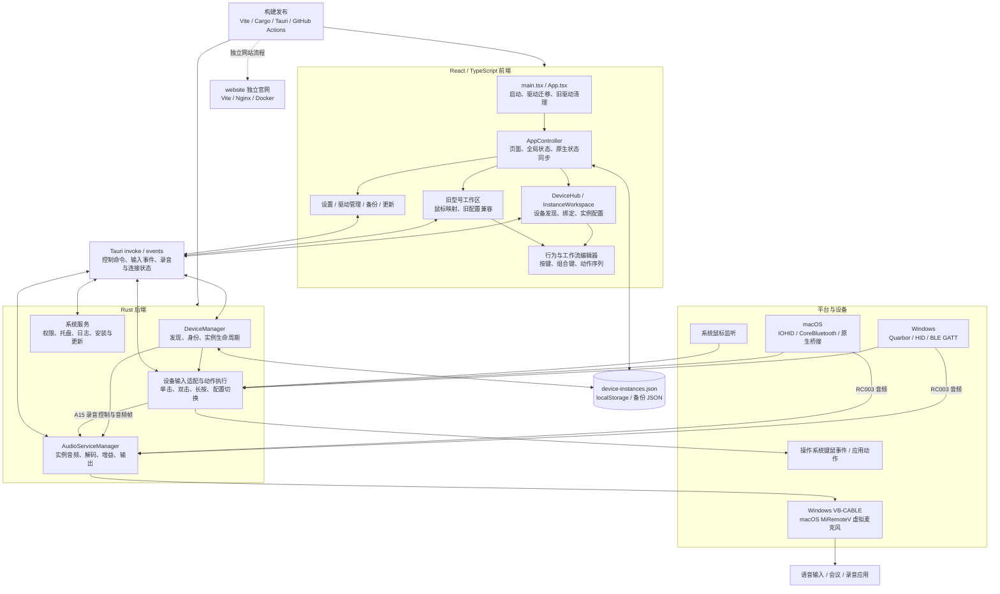

# Axonkey 废弃代码与系统架构审计

审计日期：2026-10-27。初始审计基线：`5cf0030`。下文代码位置和问题清单描述清理前状态；用户随后授权的清理结果见本节。

## 已执行的清理

已按用户指定范围完成 A1、A2 和 B 类清理：移除 6 个无生产入口文件、旧总览及工具栏、旧首页回退、旧集成弹窗、4 个未使用声明，以及相关状态、专属 CSS 和退役组件测试。旧总览专用的遥控器高亮参数与悬停回调也已移除。

共享设备卡片样式从 `MyDevicesPage.css` 迁移至 `src/devices/integration/DeviceCards.css`，由 `DeviceHub` 直接导入；旧首页专属选择器已清理。首页页脚、鼠标工作区、备份偏好兼容和旧路由回到首页的迁移逻辑保留。同步更新设备目录说明、UI 技能入口及发布测试列表。C 类候选和 E1 的 macOS RC003 问题不在此次清理范围内。

- 删除 14 个产品或测试文件，另迁移 1 个共享样式文件。
- `npm run build`、额外 TS 未使用声明检查、`git diff --check` 均通过。
- 遥控器交互、首页页脚、设备发现、实例配置、设备映射和鼠标 UI 的相关测试：38 项全部通过。
- 发布测试：299 项，254 通过、13 失败、32 跳过。剩余失败均已存在于清理前基线，涉及配置迁移及备份测试，未产生新的失败项。
- 浏览器预览确认首页卡片与页脚正常显示，新集成弹窗能打开，鼠标映射工作区可进入。未进行原生平台或硬件回归。
- 构建产物主 JS 从 644.40 kB 降至 630.17 kB，CSS 从 156.60 kB 降至 145.09 kB（Vite 输出的未 gzip 大小）。

## 结论

项目正从“按设备型号管理配置”迁移到“按实物绑定、按实例管理配置”。因此存在三种不同情况：确实没有生产入口的遗留实现、仍承担兼容职责的旧实现，以及因接线错误而不可达的必要实现。不能把名字带 `legacy`、Windows 编译出现 `dead_code` 警告、或没有被桌面前端导入的文件统一删除。

确认了 6 个没有接入前端生产入口的 TS/TSX 文件，合计约 94 行；还确认旧总览路由、旧首页回退及旧集成弹窗没有当前产品入口。较大的维护负担在后者及新旧状态共存，而非这几个小文件。

此外发现 macOS RC003 的实例读取器被调用条件排除，属于需要修复的功能接线问题，不能作为废弃实现删除。

## 方法与边界

- 从 `src/main.tsx` 建立 TypeScript 模块引用图，跟踪静态导入、再导出与字面量动态导入；保留类型导入，避免过度判定。108 个 TS/TSX 文件中，101 个可达，另有 6 个不可达实现文件和 1 个声明文件。
- 对“仍被 import，但产品流程已经不能到达”的页面人工检查路由、状态初始化、状态写入与唯一调用点。
- 检查 Tauri 命令注册及前端、独立 HTML、动态拼接命令调用；检查 Rust 平台条件编译、设备读取器、录音和输出服务。
- 检查测试、脚本、官网、静态资源、原生桥接和 vendor 的职责；没有逐行证明所有 vendor、原生代码和 CSS 都不存在其他死代码。
- 在 Windows 执行前端构建、Rust 检查及发布测试。没有在 macOS 编译或进行硬件端到端验证。

## A. 可以优先清理的代码

### A1. 无生产入口的 6 个文件

| 文件 | 依据 | 清理时需要同步处理 |
| --- | --- | --- |
| `src/components/SidebarButton.tsx` | 生产源码没有引用；只剩旧侧栏测试直接加载 | `test/sidebar-tooltip.test.mjs` 的旧侧栏测试 |
| `src/devices/integration/InstanceBehaviorEditor.tsx` | 没有导入或入口引用 | `DeviceHub.css:615` 起的专属编辑器选择器，逐个确认后清理 |
| `src/devices/cmiot-a15-remote/CmiotA15RemoteControl.tsx` | 未被设备包或页面引用的包装组件 | 检查设备目录说明，不删除实际使用的设备图组件 |
| `src/devices/cmiot-a15-remote/cmiotA15RemoteControlGeometry.ts` | 无引用的 geometry 再导出别名 | 保留实际使用的 `geometry.ts` |
| `src/devices/xiaomi-remote/XiaomiRemoteControl.tsx` | 未被设备包或页面引用的包装组件 | 同上 |
| `src/devices/xiaomi-remote/xiaomiRemoteControlGeometry.ts` | 无引用的 geometry 再导出别名 | 保留实际使用的 `geometry.ts` |

这些文件原本没有进入生产入口，删除它们主要减少维护误导，不应把源码行数直接换算成最终 JS 体积收益。

### A2. 未使用的局部声明

额外启用 `noUnusedLocals` / `noUnusedParameters` 后发现：

| 位置 | 声明 |
| --- | --- |
| `src/app/AppController.tsx:26` | 未使用的 `X` 图标导入 |
| `src/app/AppController.tsx:261` | 未使用的 `setSidebarCollapsed` setter |
| `src/behaviorModel.ts:234` | 未使用的 `isTriggerType` 函数 |
| `src/components/BehaviorEditor.tsx:33` | 未使用的 `InputId` 类型导入 |

`sidebarCollapsed` 的值仍参与 UI 状态保存和备份恢复。可以删除未使用的 setter，但删除持久化字段应单独决定旧备份兼容策略。

## B. 文件有引用，但当前产品流程不可达

### B1. 旧总览页面

证据链：

1. `src/appConfig.tsx:135` 将保存的 `overview` 页面恢复为 `home`。
2. 当前生产导航没有跳转到 `overview` 的调用。
3. `src/app/AppController.tsx:1940` 仍保留仅在该路由显示的 `AppHeader`；`:1955` 仍保留 `MappingOverview` 分支。
4. `overviewSelection`、页面类型枚举及总览专属样式仍存在。

建议作为一个清理单元移除路由分支、相关组件、专属状态和样式。`styles.css:4735` 起有总览样式，后面还有平台覆盖；不能直接删除一个大段，因为部分选择器与其他页面合并声明。

### B2. 旧设备首页与旧集成弹窗

证据链：

1. `src/components/HomeDashboard.tsx:37` 使用 `deviceContent ?? <MyDevicesPage ... />`。
2. 唯一生产调用 `src/app/AppController.tsx:2138` 始终传入 `<DeviceHub />`，所以旧首页回退不会渲染。
3. `AppController.tsx:2196` 的 `onIntegrate` 只传给旧首页回退，它是把旧弹窗状态设为 `true` 的入口。
4. 旧 `DeviceIntegrationDialog` 分支因此无法从当前 UI 打开。新首页使用 `DeviceHub` 自己的集成流程。

可以清理旧回退、旧弹窗、旧首页专用 props、`overviewDevices` 计算及相应测试，但有两个明确约束：

- `HomeDashboard` 页脚仍是当前设置、权限、日志、关于的入口，组件本身必须保留。
- **`MyDevicesPage.css` 不能整文件删除。** 新 `DeviceHub` 仍使用 `my-devices-*` 类，且样式目前通过旧组件的 import 链加载。移除旧组件时必须保留或迁移这条样式入口。

### B3. 专属 CSS 残留

`src/devices/integration/DeviceHub.css:615` 起的 `.managed-behavior-editor`、`.managed-trigger-tabs`、`.managed-action-list`、`.managed-add-action` 等选择器只对应未接入的 `InstanceBehaviorEditor`。这部分可以随组件清理；共享的 `.managed-caption` 等规则不能顺带删除。

## C. 待清理候选，不能仅凭“没有调用”直接定性

| 候选 | 证据与处置建议 |
| --- | --- |
| `src-tauri/src/lib.rs:245` 的 `ping` | 注册了 Tauri 命令，仓库内没有调用；确认不需要人工诊断接口后移除注册和函数 |
| `src-tauri/src/lib.rs:269` 的 `get_log_info` | 仓库内无前端调用，日志入口使用其他路径；不要误删被其他代码使用的底层日志信息函数 |
| `src-tauri/src/lib.rs:1246` 的 `probe_audio_available` | 当前页面使用其他音频状态探测命令；属于多余公开接口候选 |
| `src-tauri/src/audio_service/mod.rs:230` 的管理器 `set_output_device` | 管理器包装方法无调用；`:192` 的实例同步仍调用平台服务同名方法，平台方法必须保留 |
| `public/rc003-remote.png`、`public/rc003-remote-keymap.png`、`public/rc003-remote-cutout.png` | 未找到运行时资源引用，三个文件约 1.21 MiB，构建仍复制到 `web-dist`；SVG 描述文字提及 keymap PNG，可能是美术参考。官网使用的是 `website/assets/` 下另一份 cutout，不能混为同一个文件 |
| `scripts/benchmark_tokens.py` | 独立模型接口 token 压测工具，未发现项目流程调用，与设备功能无直接关系；建议确认用途后移出项目或归档，不能据此断言手工工具从未使用 |

## D. 明确不应当作废弃代码处理

| 模块 | 仍然存在的职责 |
| --- | --- |
| `MappingPage`、`BehaviorEditor`、旧工作区 | 系统鼠标仍进入旧映射链路；“启用新编辑器”开关仍选择两种编辑方式 |
| 旧型号配置、`deviceProfiles`、`instanceProfiles` 的迁移逻辑 | 兼容已保存配置、旧备份及向设备实例迁移，不能在未完成数据迁移时删除 |
| 旧 `InputService` 和兼容音频服务 | 仍承担兼容路径及与实例管理器之间的设备所有权交接 |
| `devices/cmiot_a15.rs` 的 `HidSession` | Windows 检查可能提示未构造，但 macOS A15 直接使用 |
| 音频暂停、恢复、监控、macOS 权限相关函数 | 部分只在 macOS 条件编译分支使用，Windows 的 dead-code 警告不足以证明废弃 |
| `DriverMigrationDialog`、`LegacyCleanupDialog` 及相关 Rust 命令 | `App.tsx` 启动流程仍使用；命令名通过字符串拼接生成，不能只搜索字面量 invoke |
| `public/bluetooth-signal.html` | Tauri 独立诊断窗口，入口在 `lib.rs`，不属于 React 模块图 |
| `scripts/bluetooth-signal-monitor.py` | 文档中仍有使用说明的独立诊断工具 |
| `scripts/release.sh` | 转发到现有发布脚本的手工入口；没有被应用导入并不表示废弃 |
| `website/` | 独立官网构建和部署，不应从桌面 import 图判定其存活 |
| libsiren 编码器及旧解码 API 的测试路径 | 部分用于生成或验证音频测试数据；不能只看到生产使用 headerless G.722.1 就删除全部测试支持 |

## E. 审计发现的功能与测试问题

### E1. macOS RC003 实例输入链路被条件排除

`src-tauri/src/input_service/managed/mod.rs:785` 为 `rc003` 实现了 macOS `RemoteReader::open` 分支。但是该函数唯一生产调用处 `:1367` 的条件包含：

```rust
if status.state == "opening"
    && instance.kind != "rc003"
    && !readers.contains_key(&instance.id)
```

因此 macOS RC003 无法进入该打开流程。与此同时，`:1289` 起会因存在已绑定 RC003 实例而把设备所有权交给实例管理器。静态分析表明：实例可能停在 opening，旧服务又已经让出设备，导致绑定后的按键输入不可用。具体硬件表现需要 macOS 实测。

Windows RC003 在此前有单独的 Quarbor 分支并 `continue`，这是正常路径，不能据此认为 macOS 也已处理。应修正平台打开条件并增加覆盖真实选择逻辑的测试，而不是删除不可达的 RC003 适配器。

### E2. 测试基线存在陈旧假设

`npm run test:release`：307 项，258 通过、17 失败、32 跳过。

| 失败组 | 数量 | 已核实的线索 |
| --- | ---: | --- |
| `common-right-modifiers.test.mjs` | 1 | 用固定数组下标认定第二份配置是鼠标，加入 A15 后假设失效 |
| `data-backup.test.mjs` | 5 | 共用 fixture 的 activeProfileIds 缺少 A15；另有断言只期待 RC003 和鼠标 |
| `data-backup-ui.test.mjs` | 7 | 共用上述 fixture，创建备份会先失败，导致后续保存对话框、导出按钮断言连带失败；修复 fixture 后仍需重跑逐项确认 |
| `device-integration-dialog.test.mjs` | 1 | 仍期待只有 RC003 和鼠标，当前旧弹窗已有 A15 |
| `home-refresh.test.mjs`、`home-status-actions.test.mjs` | 2 个文件级失败 | 测试 VM 按 CommonJS 加载组件，遇到图标 URL 中的 `import.meta` 失败 |
| `sidebar-tooltip.test.mjs` | 1 | 加载 `AppHeader.tsx` 却尝试渲染不存在的 `AppSidebar` 导出 |

这不等于发现 17 个产品功能故障，也不意味着应该直接删除 17 个测试。仍有效的备份、迁移、首页和导航行为应由匹配当前实现的测试覆盖。

### E3. 文档和维护热点

- `docs/DEVICE_INTEGRATION.md:30` 仍写 Windows A15 录音保留兼容服务，未完整反映现有按实例服务与 macOS A15 接入，应更新架构描述。
- `AppController.tsx` 约 2431 行、`styles.css` 约 6598 行、`lib.rs` 约 1973 行、Windows 输入服务约 3107 行。这些是维护热点，不是废弃代码证据。优先清除已证实不可达分支，再考虑模块拆分。

## 整体系统框架



图表达模块职责；macOS RC003 的实例输入边目前存在 E1 所述断点，不能把图视为全部平台端到端验收通过。PCM 音频在原生后端流转，前端主要接收状态、电平和诊断数据。

### 设备与音频路径

| 设备 / 平台 | 输入与控制 | 音频 |
| --- | --- | --- |
| A15 / Windows | Quarbor 捕获 → A15 报告解析 → 映射动作 | F8 录音状态、FB 控制、FC 分片 → G.722.1 解码 → PCM → cpal → 选定输出，通常为 VB-CABLE |
| A15 / macOS | 独占 HID → A15Reader / HidSession → 原生按键动作 | 复用 A15 协议与解码 → 实例音频桥接 → AVAudioEngine → MiRemoteV；本次未进行 macOS 实机验证 |
| RC003 / Windows | Quarbor → 输入服务 → 映射动作 | BLE GATT / ATVV → ADPCM → PCM → Windows 输出 |
| RC003 / macOS | 预期为实例 RemoteReader → macOS 输入桥接；当前打开条件存在断点 | CoreBluetooth → ADPCM → 原生音频桥接 → MiRemoteV；多设备身份准确性仍需实机验证 |
| Xbox 蓝牙设备支持包 | macOS 通用 HID 报告解析 → 手势 → 动作；不是所有平台/型号通用支持 | 无遥控器录音链路 |
| 系统鼠标 | 独立 MouseService 监听，配置入口仍使用旧工作区 | 无遥控器录音链路 |

### 状态与数据的实际分工

- `device-instances.json`：Rust 实例管理器保存设备实例、实物绑定、配置及输出参数。
- `localStorage`：旧型号配置、UI 偏好、保存的动作序列等；浏览器预览另有实例模拟存储。
- Tauri events：通知输入、配置切换等；前端还通过命令获取连接、录音和音频状态。
- 备份 JSON：负责导入导出及历史格式兼容；不能在删除旧 UI 时连同旧数据读取一起删除。
- `public/bluetooth-signal.html` 和配置切换浮层属于额外窗口入口，应纳入入口审计。

## 验证结果与建议顺序

| 检查 | 结果 |
| --- | --- |
| `npm run build` | 通过；有超过 500 kB 的 JS chunk 提示 |
| `cargo check --manifest-path src-tauri/Cargo.toml --lib --message-format=json` | Windows 通过，有条件编译未使用项等警告 |
| 额外启用 TS 未使用声明检查 | 4 个诊断，见 A2；不等于默认构建失败 |
| `npm run test:release` | 258 通过、17 失败、32 跳过，见 E2 |
| macOS 编译、设备硬件端到端验证 | 本次未执行 |

建议按以下顺序安排后续改动：

1. 单独修复 macOS RC003 实例打开条件；修复陈旧测试 fixture 与加载方式，建立可用的回归基线。
2. 清理 6 个无入口文件、4 个未使用声明及已核实的专属 CSS；对无调用命令和 PNG 候选确认用途后清理。
3. 成组移除旧总览路由、旧首页回退及旧集成弹窗，保留新首页仍需要的共享样式和页脚。
4. 在鼠标迁入实例工作区、历史配置完成迁移之后，再评估旧工作区与兼容服务的退役。不要把这一步混入简单死代码清理。
