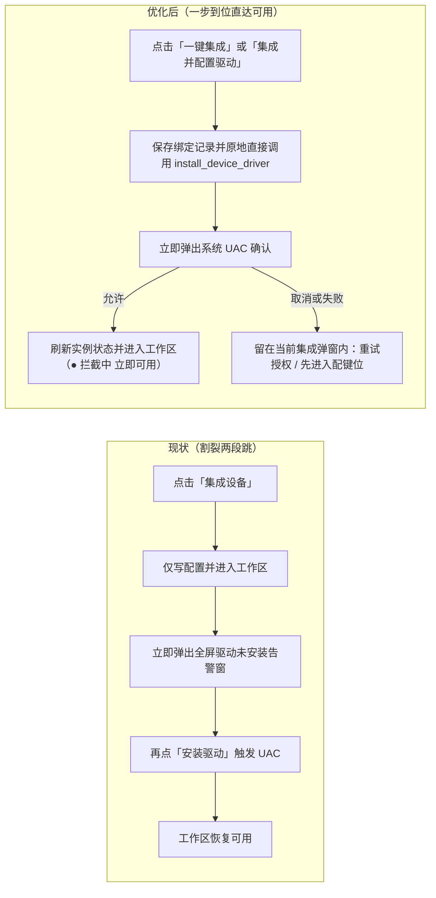

# Axonkey 桌面端 UI/UX 精简与跨平台统一方案

更新日期：2026-11-12
可交互原型：[ui-ux-prototype.html](ui-ux-prototype.html)

本方案面向 Axonkey 桌面端（macOS / Windows 11），目标是收敛页面层级、明确“设备实例级设置”与“应用全局设置”的边界、打通 Windows 新设备集成直达可用的 UAC 驱动链路、消除单步与多步行为编辑时的布局跳变，并在不破坏各系统原生窗口习惯的前提下统一双平台体验与样式维护结构。

---

## 1. 现状核心痛点

1. **导航与状态入口分散，设备级设置与全局设置易混淆**
   - 底部常驻导航栏（`AppBottomBar`）、首页右侧系统权限长栏、工作区多行头部并存；多设备之间切换需要先退回首页再进入目标设备。
   - 单台设备的“设备设置”与“设备信息”拆成了两个独立抽屉按钮，且容易与全局应用设置产生概念碰撞。
2. **Windows 新设备集成链路割裂（二次异常弹窗才触发 UAC）**
   - 现有 `DeviceHub.tsx` 中点击「集成设备」仅保存实例配置就立即跳入 `InstanceWorkspace.tsx`；刚进编辑页即因 `driverMissing` 弹出全屏告警遮罩（`managed-driver-notice-backdrop`：“按键驱动未安装，请先安装此设备的按键驱动”），用户再点一次「安装驱动」才真正调用 `install_device_driver` 触发 Windows UAC。一次正常接入被拆成“点集成 → 进页面被异常弹窗打断 → 再点安装 → 弹 UAC”的多步折返。
3. **高频按键配置链路偏重**
   - 映射工作区同时常驻设备图、行为工具箱（`WorkflowToolbox`）、触发泳道与步骤弹窗（`WorkflowStepDialog`），横向空间被挤压；最常见的“改一个快捷键 / 改一段提示词”往往需要拖拽或打开多层弹窗。
4. **单行为与多行为编辑状态割裂**
   - 空态（0 个行为）、单步（1 个行为）与序列（2 个及以上行为）若采用不同的“添加步骤”按钮位置与文案，用户在从 1 步追加第 2 步时按钮会发生跳变，步骤自身操作与卡片级操作也容易混淆。
5. **macOS 与 Windows 11 体验及样式维护分叉**
   - **顶栏结构不一致**：macOS 在 `Overlay` 标题栏下额外占一条 28px 空白 `.native-titlebar` 再叠 60px 业务头栏；Windows 使用原生标题栏加 60px 头栏。
   - **样式补丁重**：`src/styles.css` 末尾通过 240+ 行 `.macos-vibrancy` 选择器覆盖实色样式，新增或调整组件时容易双端失步。

---

## 2. 信息架构与交互优化方案

### 2.1 单顶栏收敛与设备速切

- 移除底部常驻导航栏，全应用共用同一条 **50px 业务顶栏（`.window-topbar`）**。
- **工作区顶栏左区（当前设备身份域）**：返回首页图标按钮 + **设备速切下拉菜单**（一键在已接入遥控器、鼠标、手柄间切换，无需回首页）+ 实时拦截/电量状态胶囊 + 当前设备启用开关 + **`设备设置` 抽屉入口**。
- **工作区顶栏右区（映射层与全局域）**：应用专属键位层分段胶囊（`全局` / `Cursor` / `Claude Code` / `+`）+ `跟随前台` 开关 + 最右侧全局设置齿轮 `⚙️`。

### 2.2 按键映射工作区：双栏一屏直达

收起常驻的独立“行为工具箱”列，改为按需唤起的轻量动作选择浮层，将工作区简化为清晰的双栏：

- **左栏（260px，设备与速览）**
  - 顶部提供 `遥控器`（SVG 可视热区）与 `已配速览`（文字列表）分段切换。
  - 设备 SVG 上已配置按键使用低饱和柔和描边与浅色半透底，不放置遮挡按键图标的中心圆点；选中态以蓝色描边高亮，按下态以绿色反馈。
  - 底部固定单行语音输入状态条（实时电平动画 + `校准` 入口）。
- **右栏（自适应，按键触发编排区）**
  - 顶部仅保留当前选中按键标识与 `恢复默认输入` 按钮，不添加多余横线或解释性副标题。
  - 主体按触发方式纵向排列触发器卡片（如 `单击`、`双击`、`长按`）。

### 2.3 触发器卡片：固定三栏与零位移编辑

每张触发器卡片统一采用 **`[ 触发条件 ] + [ 行为栈 ] + [ + 添加 ]` 固定三栏结构**，彻底消除 0 / 1 / 多行为切换时的割裂感：

```text
[ 单击 ]   [ 1  快捷键    [ ⌘ + K ]  快速唤醒指令面板          ↓ × ]   [ + 添加 ]
           [ 2  粘贴提示词 "请审查当前改动..."  [↵ 自动回车]   ↑ × ]
```

- **左栏（48px，首行对齐）**：固定展示触发方式名称，首行高度固定 38px，空态与非空态零位移。
- **中栏（自适应，行为列表）**：
  - **0 个行为**：单行 `未配置（保留原始输入）`，整行可点击直接唤起动作面板，行高与单步条一致（38px）。
  - **1 个行为**：紧凑单行展示；右侧仅保留属于该行为自身的 `×` 移除按钮。
  - **2 个及以上行为**：向下自然展开，自动显示 `1 / 2 / 3` 序号徽标，并在每个行为条右侧出现内联 `↑ / ↓` 调整顺序按钮与 `×` 移除按钮；不额外长出底部工具条，也不添加多余分隔横线。
- **右栏（固定首行右侧操作位）**：
  - 卡片级 **`+ 添加`** 按钮始终锚定在同一列、距卡片顶部同一偏移量（0px 位移），统一文案与视觉权重。连续点击添加多个步骤时，按钮与动作浮层位置保持稳定。
- **高频动作行内直编**：
  - **快捷键**：点击键帽按钮直接进入键盘按键捕获（`Esc` 取消），无需开模态框。
  - **粘贴提示词**：点击文本预览在当前行下方展开轻量编辑框（更改自动保存），右侧附带 `↵ 自动回车` 胶囊开关。
  - **等待延时**：行内数值框直接微调毫秒数。

### 2.4 首页（我的设备）与全局环境设置页

- **首页聚焦设备本身**：去掉常驻右侧系统权限侧栏，改为清爽的设备网格 + 底部已发现新设备快捷接入条。仅当某台设备缺少系统权限或驱动时，在该设备卡底部显示琥珀色行动入口（`前往授权` / `安装驱动`）。
- **全局设置页（`⚙️`）专注应用级偏好**：左侧紧凑分类导航，右侧无总标题与多余横线，采用“右对齐中文冒号标签 + 左对齐控件”双列表单，集中承载开机启动、全局环境就绪汇总（macOS TCC 权限 / Windows 虚拟麦克风与驱动总览）、账号云同步、备份日志与软件更新。

### 2.5 设备级设置与硬件信息的归属（与全局设置解耦）

由于 Axonkey 支持同时集成多个物理设备实例（包括两把同型号遥控器，如客厅与书房），实例重命名、蓝牙硬件换绑/解绑、单设备专属项（如 CMIOT-A15 语音录制模式 `按住`/`单击`）、Windows 单设备过滤驱动重装，以及蓝牙 MAC、电量、序列号、固件版本均属于 **`DeviceInstanceRecord` 实例级属性**，不应塞进右上角的全局 `⚙️` 设置页。

建议采用 **“就近双入口 + 单一右侧滑出抽屉（双页签）”** 方案：

1. **主入口（工作区顶栏左区）**：紧跟在当前设备开关右侧提供紧凑的 **`设备设置`** 按钮（同时在设备速切下拉菜单末尾保留 `当前设备设置与信息…`），视觉上归属左侧“当前设备身份域”，与最右侧全局 `⚙️` 天然区分。
2. **快捷入口（首页设备卡片右上角 `⋯`）**：在「我的设备」每张硬件设备卡右上角提供轻量 `⋯` 按钮，无需先进入按键编排工作区即可直接重命名、重新绑定、查看固件序列号或移除设备。
3. **单一抽屉内合并双页签**：将原先拆开的“设备设置”与“设备信息”合并到同一个 **392px 右侧抽屉（`DeviceSettingsDrawer`）** 中，顶部以紧凑分段切换：
   - **`设备设置` 页签**：设备名称（实时保存）、设备型号、物理绑定状态（`重新绑定` / `解除绑定` 保留键位配置）、设备专属能力项（语音触发模式、Windows 单设备驱动状态与重装）、底部行内二次确认的 `移除此设备`。
   - **`硬件信息` 页签**：蓝牙名称、蓝牙地址、当前电量、制造商、序列号、硬件版本、固件版本、软件版本，以及带 10 秒冷却倒计时的 `刷新信息` 按钮。

### 2.6 设备集成与 Windows UAC 驱动一步到位链路

消除“集成完进设备页再弹异常框点安装驱动”的断裂体验，核心原则是：**用户点击「集成」即代表授权接入该硬件，驱动安装（UAC）必须在点击集成的同一条动作链路里原地完成，进入设备工作区时直接处于绿灯可用状态。**



具体交互与代码改造落点：

1. **点击集成直接串联 UAC（`DeviceHub.tsx` + `AppController.tsx`）**
   - 将 `installManagedDriver(instanceId)` 透传给 `DeviceHub` 的已发现设备卡片（`一键集成`）与 `IntegrationDialog`（手动添加/绑定弹窗，Windows 下绑定在线硬件时主按钮文案明确为 **`集成并配置驱动`**）。
   - 点击按钮后，先执行 `controller.put(instance)` 落盘拿到 `saved.id`；若当前为 Windows 平台、`supportsWindowsDriver(kind)` 且已选定在线物理硬件（`saved.binding` 存在）且驱动尚未安装，**不跳转页面，直接在当前调用链执行 `invoke('install_device_driver', { instanceId: saved.id })`**，弹窗切换为轻量等待态 *“正在请求管理员权限安装按键驱动，请在系统 UAC 窗口中点击「是」…”*。
2. **安装完成直达可用工作区**
   - UAC 授权通过、过滤驱动挂载并完成 `deviceInstances.refresh()` 后，调用 `onComplete(saved.id)` 进入 `InstanceWorkspace`。此时 `driverInstalled === true` 且独占读取已建立，顶栏直接显示绿灯 **`● 拦截中`**，零额外弹窗、零多余点击。
3. **取消 UAC 或需重启时留在集成弹窗内闭环**
   - 若用户在系统 UAC 点了“否”、驱动返回错误或提示需先重启系统（`restart_before_install`），**不强行跳进工作区弹报错框**，而是留在当前集成弹窗内展示明确原因，提供 **`[重新授权安装]`** 与 **`[先进入配键位（稍后安装）]`** 两个按钮。
4. **彻底移除工作区全屏驱动遮罩（`InstanceWorkspace.tsx`）**
   - 删除 `InstanceWorkspace.tsx` 中的 `managed-driver-notice-backdrop` 模态遮罩逻辑；仅当用户主动选择“暂不绑定硬件”或“稍后安装驱动”进入工作区时，在工作区顶部显示与 macOS 缺权限完全同构的**非阻塞 `.readiness-banner` 内联条**（附 `安装按键驱动` 按钮）。

---

## 3. macOS 与 Windows 11 双平台统一方案

| 维度 | macOS 桌面端 | Windows 11 桌面端 | 统一方式 |
| --- | --- | --- | --- |
| **窗口标题栏** | `titleBarStyle: "Overlay"`，红黄绿内嵌至 50px 顶栏左侧安全区（`--topbar-pad-left: 82px`），省去独立 28px 空白层 | 保留系统原生标题栏（完整支持 Win11 Snap Layouts 分屏贴靠与系统控制热区），`--topbar-pad-left: 14px` | 窗口内部共用 **100% 同一套 `.window-topbar` DOM 与高度** |
| **表面材质** | 原生 Vibrancy 毛玻璃 + 半透提亮表面（`rgba(248, 250, 253, 0.72)`） | Fluent 实色浅灰底（`#f3f4f7`）+ 纯白实色卡片与抽屉（`#ffffff`），不做伪透明 | 组件只消费 `--bg-app`、`--surface-card`、`--surface-subtle`、`--surface-popover` 等根级语义变量 |
| **新设备集成** | 点击 `一键集成` 保存绑定后直达可用工作区 | 点击 `一键集成` 原地触发 UAC 装好 Quarbor 过滤驱动后直达可用工作区 | 两端点击集成后进入工作区均**立即可用、无二次拦截弹窗** |
| **权限 / 驱动引导** | 输入监控、辅助功能、`MiRemoteV` 虚拟麦状态 | Quarbor 按键拦截驱动、`Quarbor Virtual Microphone`、输入法麦克风指引 | 取消 Windows 工作区全屏遮罩窗，未就绪场景统一使用顶部**非阻塞 `.readiness-banner` 内联条**及设置页 `● 状态 + 操作按钮` 行结构 |
| **键帽与系统文案** | `⌘ / ⌃ / ⌥ / ⇧ / Return / .app / 顶部菜单栏` | `Ctrl / Alt / Shift / Enter / .exe / 系统托盘` | 存储层共用可移植动作标识（如 `Mod + K`），视图层按当前平台自动格式化渲染 |

---

## 4. 可交互原型说明

直接用浏览器打开同目录下的 [ui-ux-prototype.html](ui-ux-prototype.html) 即可离线完整体验（所有设备 SVG 已内联，无外部依赖）：

1. **设备级设置与硬件信息抽屉**：
   - 在 `1. 按键工作区` 点击顶栏左侧开关旁的 **`设备设置`**（或打开设备切换菜单点击 `当前设备设置与信息…`），以及在 `2. 我的设备` 点击任意硬件卡片右上角 **`⋯`**，均可滑出右侧单设备抽屉，体验 **`设备设置` / `硬件信息`** 双页签切换、实时重命名、10s 冷却刷新固件信息与行内移除确认。
2. **Windows 11 一键集成直触发 UAC 链路**：
   - 顶部切换到 `Windows 11 桌面端` → 进入 `2. 我的设备` → 点击底部 Xbox 无线控制器的 **`一键集成`**（或右上角 `+ 添加设备`）：观察无需先跳页报错，原地直接拉起 UAC 授权步骤；点击 **`🛡️ 允许管理员授权（进入工作区）`** 后直接进入绿灯 **`● 拦截中`** 的按键工作区；也可点击 **`模拟取消 UAC`** 验证留在原弹窗重试或先进入预配键位的兜底分支。
3. **三栏零跳变行为编排**：
   - 在 `1. 按键工作区` 点击遥控器左上角 **电源键** 或 **确认键**，点击任意触发行的 `+ 添加` 体验 `0 → 1 → 2 → 3` 步连续添加（右侧 `+ 添加` 按钮 0px 零跳变）、内联 `↑ / ↓` 排序、点击键帽录入组合键及点击提示词行内编辑。
4. **双平台实时切换与实体按键模拟**：
   - 顶部预览栏支持随时切换 `macOS 桌面端` ↔ `Windows 11 桌面端`、`⚠️ 模拟缺权限 / 缺驱动` 与 `⚡ 模拟按下实体键`。

---

## 5. 代码落点与建议分步实施顺序

后续合入正式代码时建议分 5 个独立小步推进，每步均可独立构建验证：

1. **Windows 一步到位集成与去二次弹窗**：在 `src/app/AppController.tsx`、`src/devices/integration/DeviceHub.tsx` 将 `install_device_driver` 串入集成保存动作，移除 `src/devices/integration/InstanceWorkspace.tsx` 中的 `managed-driver-notice-backdrop` 全屏告警模态框，改为顶部非阻塞内联提示条。
2. **单设备抽屉合并与双入口收敛**：演进 `src/devices/shared/DeviceSettingsDrawer.tsx`、`src/devices/integration/InstanceWorkspace.tsx` 与 `src/devices/integration/DeviceHub.tsx`，合并 `设备设置` 与 `硬件信息` 双页签，挂载到工作区顶栏左区与首页设备卡片右上角 `⋯`。
3. **表面语义变量收敛**：在 `src/styles.css` 与 `src/app/AppController.tsx` 抽出平台表面 CSS 变量，逐步收掉末尾重复的 `.macos-vibrancy` 选择器覆盖；同步对齐 `src-tauri/tauri.conf.json` 与 `src-tauri/tauri.macos.conf.json` 下的顶栏安全区。
4. **触发器卡片三栏重构与行内直编**：在 `src/components/WorkflowAxonkey.tsx`、`src/components/WorkflowToolbox.tsx`、`src/components/WorkflowStepDialog.tsx` 将常驻工具箱改为按需浮层，固定右侧 `+ 添加` 栏位并支持快捷键/提示词行内直编。
5. **单顶栏设备速切整合**：在 `src/devices/shared/DeviceWorkspaceHeader.tsx` 与 `src/app/AppController.tsx` 收敛底部导航栏并接入跨设备速切菜单。
